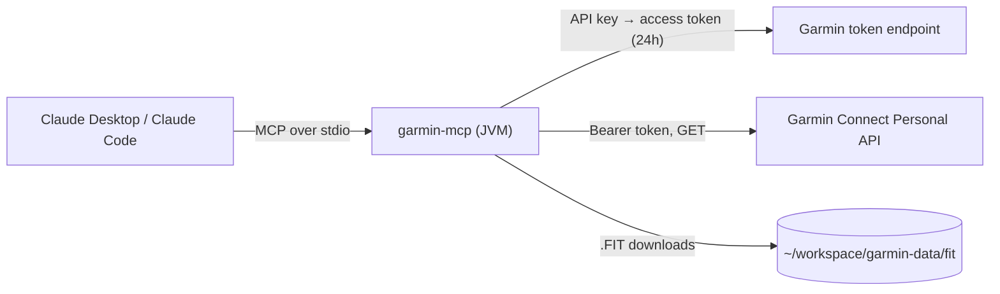

# garmin-mcp

An [MCP](https://modelcontextprotocol.io) server that connects Claude to your own Garmin Connect
data through the official **Garmin Connect Personal API**: activities, original `.FIT` files,
HRV, sleep, daily heart rate, HR zones and daily summaries, with no manual exports.

It ships with two ready-made prompts:

- **training-dashboard**: Claude pulls your last weeks of data and builds an interactive
  dashboard that puts training load next to HRV, sleep and resting heart rate;
- **social-card**: Claude turns a workout into a prompt for an image model (e.g. Gemini
  "Nano Banana") that adds your real stats to your own photo, for Instagram or WhatsApp.

Works with **Claude Desktop** and **Claude Code** (and any other MCP client that speaks stdio).

- Java 21, Spring Boot 4.1, Spring AI 2.0, MCP Java SDK 2.1 (stdio transport, protocol 2025-06-18)
- Read-only: the Personal API has no write endpoints
- The API key never leaves your machine and is never logged



## Contents

1. [Requirements](#requirements)
2. [Create the personal API key](#1-create-the-personal-api-key)
3. [Build](#2-build)
4. [Connect to Claude Desktop](#3a-connect-to-claude-desktop)
5. [Connect to Claude Code](#3b-connect-to-claude-code)
6. [The training dashboard prompt](#the-training-dashboard-prompt)
7. [The social card prompt](#the-social-card-prompt)
8. [Tools](#tools)
9. [Configuration](#configuration)
10. [Troubleshooting](#troubleshooting)
11. [How it works](#how-it-works)
12. [Security and terms](#security-and-terms)

## Requirements

- JDK **21 or newer** (the jar will not start on older JVMs)
- Maven 3.9+
- A Garmin Connect account with access to the
  [Personal API](https://developer.garmin.com/gc-developer-program/personal/)

## 1. Create the personal API key

1. Garmin Connect web → <https://connect.garmin.com/app/settings/personalApiToken>
2. *Create Key* → accept the terms → choose the expiry (max 1 year) → *Create*
3. The key is shown **only once**: save it in a file readable only by you:

```bash
mkdir -p ~/.config/garmin-mcp
nano ~/.config/garmin-mcp/api-key      # paste the key, save
chmod 600 ~/.config/garmin-mcp/api-key
```

Alternatively, set the environment variable `GARMIN_PERSONAL_API_KEY` (it wins over the file).

Check the key (prints only the HTTP status, `200` = OK):

```bash
curl -s -o /dev/null -w '%{http_code}\n' -X POST \
  'https://personal.connectapi.garmin.com/personalapitoken-service/personal-api/personal-api-key/token' \
  -H "Authorization: ApiKey $(cat ~/.config/garmin-mcp/api-key)"
```

## 2. Build

```bash
git clone https://github.com/apratico/garmin-mcp.git
cd garmin-mcp
mvn -q -DskipTests package
ls target/garmin-mcp.jar
```

You will need two absolute paths for the next step:

```bash
JAVA_BIN="$(dirname "$(readlink -f "$(which java)")")/java"   # must be Java 21+
JAR="$(pwd)/target/garmin-mcp.jar"
"$JAVA_BIN" -version && echo "$JAVA_BIN" && echo "$JAR"
```

> Use an absolute path to a Java 21+ binary. GUI apps do not read your shell profile, so a bare
> `java` may resolve to a different (older) JVM. With SDKMAN, prefer a pinned version such as
> `~/.sdkman/candidates/java/21.0.4-tem/bin/java` over `current`, which can change.

## 3a. Connect to Claude Desktop

Settings → Developer → *Edit Config* opens `claude_desktop_config.json`:

| OS | Path |
|---|---|
| Linux | `~/.config/Claude/claude_desktop_config.json` |
| macOS | `~/Library/Application Support/Claude/claude_desktop_config.json` |
| Windows | `%APPDATA%\Claude\claude_desktop_config.json` |

Add a top-level `mcpServers` key (next to any existing keys, not inside `preferences`):

```json
{
  "mcpServers": {
    "garmin": {
      "command": "/absolute/path/to/java21/bin/java",
      "args": ["-jar", "/absolute/path/to/garmin-mcp/target/garmin-mcp.jar"]
    }
  }
}
```

Quit Claude Desktop **completely** (including the tray icon) and start it again: the app spawns
the server at startup. The `garmin` tools appear in the connectors menu, and the dashboard prompt
in the **+** menu.

## 3b. Connect to Claude Code

One command, available in every project (`--scope user`):

```bash
claude mcp add garmin --scope user -- "$JAVA_BIN" -jar "$JAR"
claude mcp list          # garmin: ... ✔ Connected
```

Use `--scope project` instead to write a shareable `.mcp.json` in the current repository.
Inside a session, `/mcp` shows the server status and its tools.

## The training dashboard prompt

The server exposes an MCP prompt, `training-dashboard`, with one optional argument `weeks`
(default 12, max 52). It tells Claude to:

1. collect HR zones, activities, HRV, and the last 14 days of sleep and daily summaries;
2. compute weekly volume, this week vs. the 4-week average, estimated training load and the
   acute:chronic ratio, running pace and efficiency, time in zones, recovery trends;
3. build a dashboard: KPI tiles, weekly volume, consistency heatmap, **load vs. recovery** chart,
   running trends, recovery panel, recent activities with laps, and data-backed coach notes.

It never invents missing values: a failed call shows up as "n/a" in the affected widget.

### Before you run a prompt

- **Permissions**: the dashboard makes about 30 tool calls (sleep and daily summary are fetched
  one day at a time). In Claude Desktop, answer **Allow always** the first time a garmin tool asks
  for permission. In Claude Code, allow them for good with `/permissions` → add `mcp__garmin`.
- **Fresh session**: after a rebuild, prompts and tools change only in a new Claude Code session
  or after a full Claude Desktop restart.
- **Activity id**: the number at the end of the activity URL on Garmin Connect
  (`connect.garmin.com/modern/activity/<id>`), or ask Claude "list my last 5 activities".

### Run it

| Client | How to run it | Output |
|---|---|---|
| Claude Desktop | **+** in the message box → *garmin* → `training-dashboard` → set `weeks` (or leave empty) → send | interactive artifact |
| Claude Code | `/mcp__garmin__training-dashboard 8` | `garmin-dashboard.html` in the current directory; open it with `xdg-open` (Linux) or `open` (macOS) |

In Claude Code the file is ignored by git (`.gitignore`), so running the prompt from inside this
repository will not dirty it.

The prompt text lives in
[`src/main/resources/prompts/training-dashboard.md`](src/main/resources/prompts/training-dashboard.md):
edit it and rebuild to change the dashboard, or copy it into any chat by hand.

## The social card prompt

Turn a photo from your run into an Instagram / WhatsApp card with your real stats on it.
The `social-card` prompt makes Claude fetch the workout from Garmin and write a ready-to-paste
prompt for an image-editing model such as **Gemini 2.5 Flash Image ("Nano Banana")**; you attach
your photo there and get the edited image back.

| Argument | Values | Default |
|---|---|---|
| `activityId` | a Garmin activity id | latest activity |
| `style` | `clean`, `poster`, `neon`, `bib`, `magazine`, `splits` | Claude shows the menu |
| `format` | `story` (9:16), `post` (4:5), `square` (1:1) | Claude asks |

| Style | Look |
|---|---|
| `clean` | minimal bottom gradient, one row of thin white stats |
| `poster` | huge condensed number behind the runner (depth effect) |
| `neon` | night grade, glowing cyan/magenta stats |
| `bib` | stats printed on a pinned paper race bib |
| `magazine` | running magazine cover with cover lines |
| `splits` | glass card with a bar chart of the km splits |

What you get back:

1. the stats used, to double-check them;
2. the image prompt, in one code block;
3. an Instagram caption and a WhatsApp status line;
4. a tip on fixing the text if the image model misspells a number.

Workflow:

1. **Ask Claude for the prompt**
   - Claude Desktop: **+** in the message box → *garmin* → `social-card` → fill the arguments
     (all optional) → send.
   - Claude Code: arguments are positional, in the order `activityId style format`; use
     `latest` for the most recent activity:

     ```
     /mcp__garmin__social-card latest poster story
     /mcp__garmin__social-card 24843355045 bib post
     ```
2. **Copy** the image prompt from the code block.
3. **Generate the image**
   - [Gemini app](https://gemini.google.com): pick the image model (Nano Banana), attach your
     photo, paste the prompt, send.
   - [Google AI Studio](https://aistudio.google.com): model `gemini-2.5-flash-image`, set the
     aspect ratio to match the format, attach the photo, paste the prompt, run.
4. **Check the numbers** on the image against the stats line; if one is wrong, reply to the
   image model with the fix suggested in the tip (e.g. `fix the text: the time must read 1:38:42`).
5. Post it, with the caption Claude wrote.

The prompt tells the image model to keep you **identical** (no beautifying, no body changes),
to keep graphics off your face and to render only the quoted text. Image models can still
misspell numbers, so the stats line is there for a final check. By default no map or start
location is used, and heart rate is left out on request.

Prompt text and worked examples:
[`src/main/resources/prompts/social-card.md`](src/main/resources/prompts/social-card.md).

## Tools

| Tool | Endpoint | Notes |
|---|---|---|
| `listActivities` | `/activitylist-service/activities/search/activities` | compact summary (km, pace, HR, cadence, ascent); `raw=true` for full JSON |
| `getActivity` | `/activity-service/activity/{id}` | summary, metadata, splits/laps |
| `downloadActivityFit` | `/download-service/files/activity/{id}` | saves `{id}.fit` under `garmin.data-dir/fit` |
| `getHrvRange` | `/hrv-service/hrv/daily/{from}/{to}` | overnight HRV |
| `getDailyHeartRate` | `/wellness-service/wellness/dailyHeartRate` | includes resting HR |
| `getSleep` | `/sleep-service/sleep/dailySleep` | date = the morning you woke up |
| `getHeartRateZones` | `/biometric-service/heartRateZones/v2` | |
| `getDailySummary` | `/usersummary-service/usersummary/daily` | steps, stress, body battery |
| `garminGet` | any other GET | relative path + query string |

Dates are `yyyy-MM-dd`. The Swagger summary does not always spell out query parameter names: if
an endpoint answers 400, `garminGet` lets Claude try another name without a rebuild.
API reference: <https://developer.garmin.com/gc-developer-program/personal/swagger-docs/>

## Configuration

`src/main/resources/application.yml`; every value can be overridden at launch with
`--garmin.data-dir=...` style arguments (after the jar in `args`) or environment variables
(`GARMIN_DATADIR`, `GARMIN_BASEURL`, ...).

| Property | Default | Meaning |
|---|---|---|
| `garmin.base-url` | `https://personal.connectapi.garmin.com` | Personal API host |
| `garmin.api-key-file` | `~/.config/garmin-mcp/api-key` | used when `GARMIN_PERSONAL_API_KEY` is not set |
| `garmin.data-dir` | `~/workspace/garmin-data` | where `.FIT` files are saved |
| `logging.file.name` | `~/.cache/garmin-mcp/garmin-mcp.log` | server log |

## Troubleshooting

| Symptom | Fix |
|---|---|
| Server does not appear / fails at start | Check the Java path is 21+: `/path/to/java -version`. `UnsupportedClassVersionError` means an older JVM. |
| Code changes have no effect | The client keeps the old JVM running: rebuild, then restart Claude Desktop (fully) or the Claude Code session. |
| `Token request failed: HTTP 401/403` | Key wrong, expired or revoked: create a new one. The error includes Garmin's Content-Type and body. |
| An endpoint answers 400 | Parameter name mismatch: use `garminGet` with the right query string. |
| Need details | Server log: `~/.cache/garmin-mcp/garmin-mcp.log`. Claude Desktop also writes `~/.config/Claude/logs/mcp-server-garmin.log` (Linux). |

Manual smoke test (the server must answer with a single JSON line):

```bash
echo '{"jsonrpc":"2.0","id":1,"method":"initialize","params":{"protocolVersion":"2024-11-05","capabilities":{},"clientInfo":{"name":"t","version":"1"}}}' \
  | timeout 10 "$JAVA_BIN" -jar "$JAR"
```

## How it works

- **Transport**: stdio. The client starts the jar as a child process and talks JSON-RPC over
  stdin/stdout; the process lives as long as the client. Nothing else may be written to stdout,
  so logging goes to a file only (`logback-spring.xml`).
- **Auth**: API key → `POST .../personal-api-key/token` → access token valid 24h (no refresh
  token). The token is cached in memory, renewed before expiry and after a `401`. Garmin may
  return it as JSON or as plain text; both are handled.
- **Content negotiation**: JSON calls send `Accept: application/json` and retry once with `*/*`
  on `406`.
- **Code map**:
  - `GarminApiClient`: HTTP, token lifecycle, retries
  - `GarminTools`: MCP tools (`@Tool` methods)
  - `GarminPrompts`: MCP prompts, texts in `src/main/resources/prompts/`
  - `GarminProperties`: `garmin.*` configuration

## Security and terms

- The API key is read from a `chmod 600` file or an environment variable, never logged, never
  sent anywhere but Garmin's token endpoint. The access token is kept in memory only.
- `.gitignore` excludes `api-key` and `*.fit` files.
- Revoke the key at any time from the Garmin Connect page where you created it.
- The Personal API is for personal, non-commercial use under Garmin's terms. This project is not
  affiliated with or endorsed by Garmin.

## License

[MIT](LICENSE)
